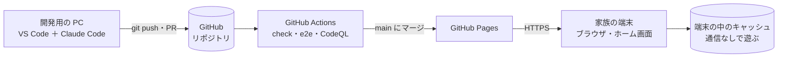

# のりものアドベンチャー（nori-adventure）

4〜8歳の子どもと家族が、スマホ・タブレット・PC のブラウザで遊べる、オリジナルの 3D 乗り物アクションゲーム。街・山道・空・海・月面を、車・列車・飛行機・潜水艇・ローバーで旅する。
インストール不要・無料・広告なし・課金なし・データ収集なし。ホーム画面に追加すれば、通信なし（機内モード）でも遊べる。

> 状態：開発中（2026-11-05〜11-30、6 スプリント。1 スプリントは最大 7 日）。5 ステージとも下の URL で遊べる。家族のテストで直してから v1.0 として出し、最後のスプリントで紹介動画（5〜7 分）を作る。12 月以降はオンライン対戦へ広げられる作りにしている

**遊ぶ：<https://hayato-f110.github.io/nori-adventure/>**

_An original 3D vehicle game for children aged 4–8 and their families. Runs in the browser on phones, tablets and PCs — free, no ads, no in-app purchases, no data collection, and playable offline once added to the home screen._

## ステージ

| ステージ | 場所 | 乗り物   | 遊びのポイント                               | ゴール                         |
| -------- | ---- | -------- | -------------------------------------------- | ------------------------------ |
| 1        | 街   | 車       | 基本の操作を覚える。ほしを集めながらドライブ | 門を通ってゴール               |
| 2        | 山道 | 列車     | 線路に沿って進むので「すすむ・とまる」だけ   | 駅に止まる                     |
| 3        | 空   | 飛行機   | 上下も動ける。手を離すと自動で水平に戻る     | 輪をくぐってゴール             |
| 4        | 海   | 潜水艇   | 光と霧の海。矢印をたよりに探す               | たからばこを見つける           |
| 5        | 月面 | ローバー | 星を集めてボスへ届ける                       | ボスを落ち着かせてエンディング |

キャラクター・乗り物・世界観はすべてオリジナル。どのステージも最初から選べる。

### やさしい決まり

- 制限時間・ゲームオーバーはない（かかった時間は表示だけ）
- ぶつかっても速さが落ちるだけ。集めたものは減らない。はまったら、近くの安全な場所からやり直す
- 難しさは 1 つだけ。順位や確率をこっそり変える補正は入れない
- 文字に頼らず、形と絵（▶ ◀ ハンドル・家の絵）で見せる。子どもが押すボタンは 64 px 以上

ルールはすべて、実装の前に数値で [docs/game-rules.md](docs/game-rules.md) に書いている。

## 遊び方

| 環境                     | 方法                                                                                                      |
| ------------------------ | --------------------------------------------------------------------------------------------------------- |
| ブラウザ（GitHub Pages） | <https://hayato-f110.github.io/nori-adventure/> を開く。横向きで遊ぶ                                      |
| ホーム画面に追加（PWA）  | 上の URL を開き、ブラウザのメニューから「ホーム画面に追加」。1 回開けば、全部のステージが通信なしで遊べる |
| PC で動かす（開発用）    | 下の「PC で動かす」                                                                                       |

PWA（Progressive Web App）は、Web のページをアプリのようにホーム画面から開き、通信なしでも動かす仕組み。Google Play などのアプリストアでは配布しない（理由は [docs/android/play-release.md](docs/android/play-release.md)）。

### 操作

| 動き                       | キーボード | タッチ                           | ゲームパッド   |
| -------------------------- | ---------- | -------------------------------- | -------------- |
| すすむ                     | ↑ / W      | 右下の大きな ▶                   | A / RT         |
| さがる                     | ↓ / S      | 右下の ◀                         | B / LT         |
| まがる                     | ← → / A D  | 左下のハンドル（左右にスライド） | 左スティック   |
| 上へ・下へ（ステージ3・4） | ↑ ↓ / W S  | 右の ▲ ▼                         | A / RT・B / LT |

音を消す・画質を選ぶ：右上のボタン（クリック・タップ）。タイトルに戻る：左上の家の絵を押し続ける（キーボードでは Tab で選んで Enter）。

保護者の方へ：左上の小さな「親子」の印を 2 秒押し続けると、プライバシーポリシー（日本語・英語）が開く。子どものうっかりのタップでは開かない。

### PC で動かす

Node.js 26 以上が必要。

```sh
npm ci
npm run dev        # http://localhost:5173/nori-adventure/ を開く
npm run check      # 型の検査・lint・整形・単体テスト
npx playwright install chromium
npm run e2e        # ビルドして、ブラウザを自動で動かして確かめる
```

URL に `?stage=1`〜`5` を付けると、そのステージから始まる。`?debug` を付けると、FPS（1 秒に描く画面の数）と速さを表示する。

## 使った技術

| 分野           | 技術                                                                                                                                   |
| -------------- | -------------------------------------------------------------------------------------------------------------------------------------- |
| ゲーム         | TypeScript（strict）、Vite、Three.js、Rapier（物理）、Web Audio API（効果音と BGM をブラウザで作る）、Gamepad API                      |
| 見た目         | PBR（光の当たり方を物理に近づける描き方）のテクスチャと空の光（CC0）、Blender での光のベイク（影を先に焼き込む）、画質の自動の切り替え |
| 3D モデル      | Blender ＋ Blender MCP（AI から Blender を動かす仕組み）→ glTF / GLB。同じモデルをゲームと紹介動画に使う                               |
| 通信なしで遊ぶ | Web App Manifest、自分で書いた Service Worker（部品を増やさないため、ライブラリを使わない）                                            |
| テスト         | Vitest（単体テスト）、Playwright（E2E：ブラウザを自動で動かす通しのテスト）                                                            |
| CI・公開       | GitHub Actions、GitHub Pages                                                                                                           |
| セキュリティ   | 脅威分析（STRIDE）、Dependabot、CodeQL、Secret scanning、`npm audit`、SBOM（部品の一覧。SPDX）、CSP                                    |
| 進め方         | Jira（スクラム、6 スプリント）、Claude Code                                                                                            |

### 作りの方針

- **状態と描画を分ける**：ゲームのルール（`src/core/`）は Three.js・画面・乱数・時計に頼らない、ふつうの TypeScript。1/60 秒ずつ進めるので、同じ入力の記録からは必ず同じ結果になる。テストで再現でき、12 月のオンライン対戦（同じ入力をそろえて進める作り）の土台になる
- **数値は 1 か所に集める**：速さ・大きさ・色などの値は `src/config/` にまとめ、`docs/game-rules.md` と同じ値かをテストで確かめる
- **安い端末で 30 fps**：対象の端末（Android のスマホ）で、5 ステージとも 1 秒あたり 30 回以上描けることを実機で測った（[docs/test-plans/NORI-34.md](docs/test-plans/NORI-34.md)）

## CI（自動の検査）と公開の流れ



1. PR（プルリクエスト）を出すと、GitHub Actions が動く
   - `check`：型の検査、lint、整形、単体テストとカバレッジ（テストが通った割合）、ビルド、`npm audit`（high 以上の脆弱性があれば失敗）、SBOM の作成
   - `e2e`：本番と同じビルドをブラウザで動かし、5 ステージのゴール・当たり・通信なしの動きなどを確かめる。ゲームの進みは時計でなく刻みの数で決めるので、PC の速さで結果が変わらない
   - CodeQL：コードの静的解析
2. `check` と `e2e` が緑のときだけ main にマージできる（GitHub のルールセット）
3. main にマージすると、ビルドして GitHub Pages に公開する（[.github/workflows/pages.yml](.github/workflows/pages.yml)）

## プライバシー方針

- 外部への通信・広告・アカウント・解析はない。個人の情報を集めない
- 端末の中に残すのは、設定 3 つ（音を消したか・画質・クリアしたステージの番号）と、通信なしで遊ぶためのゲームのファイルだけ。外へは送らない
- 子ども・家族の写真・声・顔は、リポジトリにも AI のサービスにも入れない
- プライバシーポリシー：[public/privacy.html](public/privacy.html)（ゲームの左上の「親子」の印からも開ける）

## セキュリティ

- 脆弱性の報告：[SECURITY.md](SECURITY.md)（GitHub の非公開の報告の仕組みを使う）
- 脅威分析：[docs/security/threat-model.md](docs/security/threat-model.md)（STRIDE。AI が書くコード、部品の供給網、Blender MCP、AI 動画サービス、Jira の MCP、公開。ISO/SAE 21434 との対応）
- Blender MCP は AI が書いたコードをそのまま動かすため、専用の標準ユーザーで動かし、書ける場所を 1 つのフォルダに限っている（[docs/security/blender-mcp-isolation.md](docs/security/blender-mcp-isolation.md)）
- 公開の前の確かめ：[docs/security/public-release-checklist.md](docs/security/public-release-checklist.md)
- 依存の版は固定し（`save-exact`）、lockfile をコミットしている。GitHub Actions の部品はコミット ID で固定している

## Claude Code の使い方

このプロジェクトは Claude Code と一緒に進めている。コードは Claude が書き、オーナーは依頼・確かめ・判断を受け持つ。決まりをファイルにして、AI に守らせる形にしている。

| しくみ                       | 場所                                                          | 例                                                                                           |
| ---------------------------- | ------------------------------------------------------------- | -------------------------------------------------------------------------------------------- |
| 決まり                       | [CLAUDE.md](CLAUDE.md)                                        | ルールは実装の前に数値で書く、テストは赤から始める、数値は試行錯誤で決めない                 |
| Hook（道具を使う前後の検査） | [.claude/hooks/](.claude/hooks/)                              | 削除・履歴の書き換えの前に確認する、秘密情報を守る、PR の前にコードレビューを求める          |
| スキル（手順書）             | [.claude/skills/](.claude/skills/)                            | `/game-rule`（ルールの足し方）、`/retro`（ふりかえり）、`/blender-start`（隔離した Blender） |
| サブエージェント（確認役）   | [.claude/agents/](.claude/agents/)                            | 子どもの目線の確認、プライバシーの確認、テストの一覧の初見の確認                             |
| MCP（外の道具とつなぐ）      | [.mcp.json](.mcp.json)（Blender）、claude.ai のつなぎ（Jira） | Blender の版はコミット ID で固定。Jira は課題の作成・更新まで（削除は使わない）              |

毎日の記録は [docs/devlog/](docs/devlog/)、スプリントのふりかえりは [docs/retro/](docs/retro/)。

## 文書

| ファイル                                                     | 内容                                                           |
| ------------------------------------------------------------ | -------------------------------------------------------------- |
| [docs/concept.md](docs/concept.md)                           | 企画書（コンセプト・対象・操作・ステージ）                     |
| [docs/game-rules.md](docs/game-rules.md)                     | ゲームのルール（すべて数値）                                   |
| [docs/schedule.md](docs/schedule.md)                         | スケジュールと、スプリントごとに学ぶこと                       |
| [docs/test-plans/](docs/test-plans/)                         | 課題ごとのテストの一覧（ルールとの対応と、どの課題で閉じるか） |
| [docs/assets/README.md](docs/assets/README.md)               | 3D モデルの流れ（Blender → GLB → ゲーム）                      |
| [docs/video/](docs/video/)                                   | 紹介動画と AI 動画サービスの比べ                               |
| [docs/security/](docs/security/)                             | 脅威分析、Blender MCP の隔離、公開の前の確かめ                 |
| [docs/android/play-release.md](docs/android/play-release.md) | Google Play で配布しない理由                                   |
| [docs/devlog/](docs/devlog/)・[docs/retro/](docs/retro/)     | 毎日の記録・スプリントのふりかえり                             |

画面のスクリーンショットと紹介動画は、スプリント6（11/26〜11/30）で作ってから、ここに足す。

## 素材とライセンス

| 素材                                   | 作者・出典                                                                         | ライセンス                     |
| -------------------------------------- | ---------------------------------------------------------------------------------- | ------------------------------ |
| コード                                 | このリポジトリ                                                                     | [MIT License](LICENSE)         |
| 3D モデル・画像・アイコン              | 自作（Blender）。出所は [public/models/manifest.json](public/models/manifest.json) | [CC BY 4.0](LICENSE-ASSETS.md) |
| 効果音・BGM                            | Web Audio API でブラウザの中で作る                                                 | –                              |
| テクスチャ（地面・道・壁・木の皮など） | [ambientCG](https://ambientcg.com/)                                                | CC0 1.0                        |
| 空の光（HDRI）                         | [Poly Haven](https://polyhaven.com/)                                               | CC0 1.0                        |

外部の素材 1 つずつの出所（配布元・ID・URL・SHA-256）は [public/textures/manifest.json](public/textures/manifest.json) と [LICENSE-ASSETS.md](LICENSE-ASSETS.md) にある。
